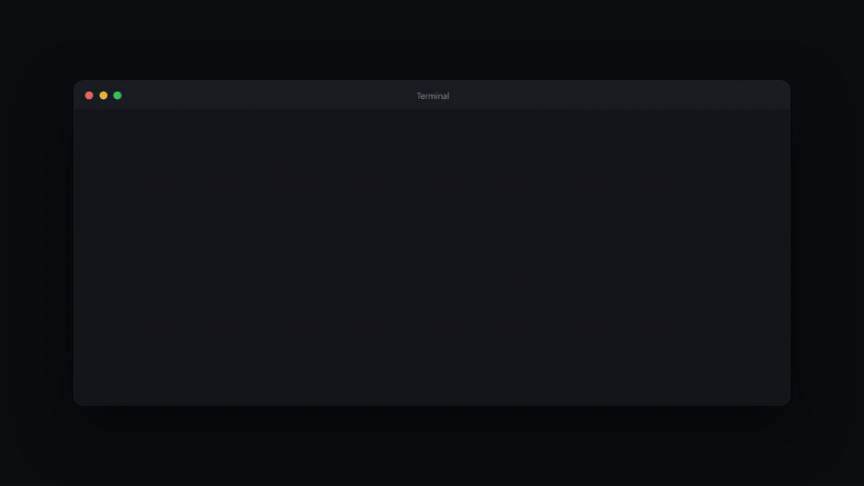

<div align="center">

# TexKit Studio



**Write papers freely. Compile without limits.**

[](https://github.com/AbidHasanRafi/texkit-studio/blob/main/LICENSE)
[](#install)
[](#privacy-and-safety)

An open-source LaTeX writing studio that runs in your browser, on your own computer.<br>
No TeX installation, no account, no compile-time limits, and nothing is uploaded.

[Install](#install) · [Use it](#use-it) · [Writing tools](#writing-tools) · [Before you submit](#before-you-submit) · [Commands](#other-commands) · [Privacy](#privacy-and-safety) · [Develop](#develop) · [Developer](#developer) · [Source on GitHub](https://github.com/AbidHasanRafi/texkit-studio)

</div>

## Why TexKit Studio

- **Nothing to set up.** One `pip install`; the LaTeX engine and Word converter come with it.
- **Unlimited compiles.** No time limit, no page limit, no queue. Auto-compile follows your typing.
- **Private.** Your files stay ordinary files in your own folder. Nothing leaves your computer.
- **Built for papers.** Every figure, table and citation is tracked, errors are explained in plain English,
  and a submission check tells you what's left before you send it.

## Install

You need Python 3.10 or newer. Then:

```bash
pipx install texkit-studio      # recommended: keeps it in its own environment
# or
pip install texkit-studio
```

That gives you the `texkit` command. Windows, Linux and macOS are supported; it has been tested on Windows and
Linux (macOS wheels are built the same way but haven't been tried yet).

- **The LaTeX engine** ([Tectonic](https://tectonic-typesetting.github.io)) is included in the platform wheels. If
  your platform has none, it's downloaded and checksum-verified the first time you compile.
- **LaTeX packages.** The platform wheels also carry a package cache (about 32 MB zipped, 89 MB unpacked) with the
  common classes at 10, 11 and 12pt, about 190 popular packages, the standard fonts, BibTeX styles and the main
  babel languages. It's unpacked once on the first compile, so ordinary documents compile with no internet at all.
  Anything outside it is fetched the first time a document uses it, then cached. `texkit doctor` shows the state
  and `texkit prepare-offline` fetches the rest of what the templates need. With the pure wheel (or a source
  install) every package is fetched on first use instead, and that first compile can take a few minutes.
- On Ubuntu and Debian, prefer `pipx` (`sudo apt install pipx`): a plain `pip install` into the system Python is
  blocked there, and `python3 -m venv` needs the `python3-venv` package.

## Use it

Go to the folder with your paper and run the command, the same way `code .` works:

```bash
cd ~/papers/my-thesis
texkit
```

Your browser opens on that folder: files on the left, the editor in the middle, the PDF on the right.
Your files stay ordinary files in that folder, so Git, Dropbox and other editors keep working.

- **Change folder from the UI.** Click the folder name in the toolbar to open another folder (a
  built-in folder browser with drives, recent folders and "New folder"), start a new project from
  a template, or reveal the folder in Explorer or Finder.
- **Compile** with the button or `Ctrl/⌘ + Enter`. By default it also compiles a moment after you
  stop typing. There's no time limit.
- **Which file is compiled.** The one with the **main** badge. If you haven't chosen, it's `main.tex`
  when that is a complete document, otherwise the first file that has `\documentclass` and
  `\begin{document}` (fewest folders deep, then alphabetical). To change it, hover any `.tex` file
  (also in subfolders) and click **⋯** (or right-click) → **Set as main file**; it recompiles at once.
  A `% !TEX root = ../main.tex` line at the top of a chapter makes that chapter compile its root.
- **Problems in plain English.** Errors and warnings link to the exact line, and common mistakes
  get a one-click fix ("Replace with `\includegraphics`", "Add `\usepackage{booktabs}`").
- **Click to jump** between the source and the PDF: double-click the PDF, or press
  `Ctrl/⌘ + Shift + J` in the editor.

### Every figure, table and source connected

Many journals require every figure and table to be referred to in the text, and every
bibliography entry to be cited. TexKit Studio reads your whole document (all chapter files) and
keeps track of this for you:

- The **References** panel lists every figure, table, equation and bibliography entry, marked
  *referenced 2×* or *never referenced* / *not cited*. One click inserts a reference to it.
- The issues panel and the editor flag a figure or table that's never mentioned, a source that's
  never cited, a `\ref` or `\cite` that points nowhere, a figure without a label or caption,
  figures mentioned out of order, and citations with no bibliography printed. Each comes with a
  fix, such as adding the missing `\label` after the caption.
- **Spelling consistency:** mixing American and British spelling ("color" and "behaviour", "analyse" in
  an American text) is underlined and fixed in one click, and summarised in the Submission check. The
  language is whatever you pick under **Settings → Spelling** (Auto, US, UK or Off). Auto follows
  `\usepackage[british]{babel}` (or `american`), or whichever variant you use most. "-ize" is accepted in British text (Oxford spelling) unless you also use "-ise". Maths, code,
  citations, names in mid-sentence and affiliations are ignored. Add `% nospell` to a line to skip it, or
  `% texkit-spelling: british`, `american` or `off` anywhere to set the language or turn it off.
- **Insert reference** (`Alt+R`) and **Insert citation** (`Alt+C`) pickers search by number,
  caption, author, title or key. **Add a source by DOI or arXiv ID** fetches the BibTeX for you.
- **Check references online** (the ✓ button in the Bibliography panel, the Submission check, or `Ctrl/⌘ + K`)
  looks every entry up in Crossref, DataCite, OpenAlex and arXiv. It flags a DOI that doesn't exist or belongs
  to a different paper, a title found nowhere (a possibly invented reference), wrong authors or year,
  retractions, expressions of concern and corrections. For an entry with no DOI it finds one and adds it
  with one click. The **References** button in the header shows a red count for problems, or a green tick
  when everything is verified, and each entry in the References panel gets a badge (Verified, Retracted,
  No DOI…). It needs internet and runs only when you press the button, unless you turn on
  **Check references automatically** (in the dialog or Settings). Then only new and edited entries are looked up.
- Hover over a `\ref` or `\cite` to see what it points to. `Ctrl/⌘ + click` goes there.

### Writing tools

- **Images:** drag one into the text or paste a screenshot. It's saved to `figures/` and a
  complete figure block is inserted.
- **Tables:** build them in a grid, or paste cells from Excel or Sheets.
- **Symbols, equations and lists** from the Insert menu (`Alt+S` for symbols).
- **Command palette** (`Ctrl/⌘ + K`), search across all files (`Ctrl/⌘ + Shift + F`), an outline
  of the whole document, and focus mode.
- **Version history:** a snapshot of your text files is kept after every successful compile.
  Compare any version with now and restore it.

### Before you submit

- **Submission check** gives one list of what's left: errors, text in the margins, unreferenced
  figures and tables, uncited sources, missing files, plus page, word and abstract counts.
- **Download** a **PDF**, a **Word** file (`.docx`, converted with Pandoc; formatting is
  approximate), the whole project as a **ZIP**, or a **submission package**: one flattened `.tex`
  with its `.bbl` and only the images it uses, as arXiv and journals ask for.

### Also

- **Templates:** Starter tour, Blank article, IEEE conference, Elsevier, Thesis.
- **Import a ZIP** (for example an Overleaf download) from the folder menu, or run
  `texkit paper.zip`.
- **EPS images** (journal logos, for example MDPI's): the engine can't embed `.eps` files itself, so
  TexKit Studio uses `name-eps-converted-to.pdf` when it sits next to the image (Overleaf and Prism leave
  these behind), otherwise converts the image with [Ghostscript](https://ghostscript.com/releases/gsdnld.html)
  if it's installed. With neither, the compile still succeeds, the image is a grey placeholder, and the
  issues panel says which one. Converted files live in the build cache, not in your folder.
- **Journal and conference templates.** Templates written for pdfLaTeX compile as they do on Overleaf. The
  built-in engine is XeTeX-based, so TexKit Studio smooths over the differences before your document
  starts: pdfTeX-only commands (`\pdfgentounicode`, `\pdfglyphtounicode`, `\pdfminorversion`, ...) are
  accepted, `[pdftex]`/`[dvips]` driver options become `[xetex]`, `biblatex` switches from Biber to BibTeX
  (an info message says so), and Unicode text such as `š`, `×` or `–` prints correctly with the usual 8-bit
  fonts instead of vanishing or showing the wrong glyph.
- **A full TeX installation is used when a document needs one.** If TeX Live, MiKTeX, MacTeX or TinyTeX is
  installed, documents that need more than the built-in engine are built with it automatically: an index or
  glossary, `biblatex` with Biber styles, `minted`, packages newer than the built-in LaTeX (2021), fonts by
  name. If the built-in engine fails for such a reason, it is tried as a second attempt, and the better
  result is kept. Without one, the issues panel names what the document uses and what is missing. Run
  `texkit doctor` to see what was found. Per-folder options go in `.texkit/project.json`:

  ```json
  { "engine": "auto", "shellEscape": false, "autoInstall": false }
  ```

  `engine` is `auto` (default), `tectonic` or `system`. `shellEscape` lets that folder's documents run
  programs, which `minted` and `svg` need and which is off by default; only turn it on for documents you
  trust. `autoInstall` lets MiKTeX download missing packages; off by default because MiKTeX would otherwise
  open a dialog that an automatic compile can't answer. Set `TEXKIT_ENGINE`, `TEXKIT_SHELL_ESCAPE=1` or
  `TEXKIT_TEXBIN` (the folder holding the TeX programs) in the environment to override them.
- **Offline:** if there's no internet, compiles fall back to packages already downloaded.
  "Prepare for offline use" downloads everything the templates need.
- Works on desktop, tablet and phone widths, in light and dark mode.

### Other commands

```text
texkit PATH            open another folder (or the folder of a .tex file, or a .zip)
texkit --port 9000     use a different port (default 8765; a free one is picked if busy)
texkit --no-browser    start without opening a browser tab
texkit compile [PATH]  compile without the UI and print any problems (handy for CI)
texkit format [PATH]   tidy .tex and .bib files, like Prettier (--check for CI)
texkit prepare-offline download the packages the templates use, for offline work
texkit doctor          check the engine, Word export and folders
```

Running `texkit` again while it's already open switches the open studio to the new folder
instead of starting a second copy.

### Formatting, like Prettier

**Format document** (`Shift+Alt+F`, the wand button, or `texkit format` in a terminal) tidies the
open file: it indents environments, `\item` text and multi-line `{...}` groups, lines up the `&`
columns of tables and aligned equations, removes trailing spaces and squeezes extra blank lines.
In `.tex` files it only ever changes whitespace, so the PDF stays exactly the same; `verbatim` and
`lstlisting` blocks are left untouched. In `.bib` files it puts one field per line with the `=`
signs lined up. Turn on *Format when I press Ctrl/⌘+S* in Settings to tidy on every save.

```bash
texkit format               # tidy every .tex and .bib file in this folder
texkit format --check       # change nothing; exit 1 if anything needs tidying (for CI)
texkit format --indent 4 chapters/
```

## Privacy and safety

The server listens on `127.0.0.1` only, and every request needs a session cookie set by the link
the command opens. Requests with another `Host` header are rejected, which blocks DNS-rebinding
attacks. Documents can't run programs (shell-escape is off) unless you turn on `shellEscape` for that
folder yourself. Deleting a file moves it to the
Recycle Bin or Trash. Your files are never uploaded. The only things that go online are the actions
you start: looking up a DOI, and **Check references online**, which sends each entry's title, first
author and DOI to Crossref, DataCite, OpenAlex and arXiv.

## Develop

A pure Python repository: no Node.js or build step. The web UI is plain JavaScript modules in
`src/texkit_studio/static/`, with CodeMirror and PDF.js vendored by `scripts/vendor.py`.

```bash
git clone https://github.com/AbidHasanRafi/texkit-studio.git
cd texkit-studio
python -m venv .venv
.venv/Scripts/activate            # Windows (on macOS/Linux: source .venv/bin/activate)
pip install -e ".[dev]"
pytest
texkit path/to/a/paper
```

Edit any file in `static/` and reload the browser to see the change. Found a bug or have an idea? [Open an issue](https://github.com/AbidHasanRafi/texkit-studio/issues).

The animation at the top is recorded from the real app: `pip install playwright`, have `ffmpeg` on your PATH,
then run `python scripts/make_demo.py` to regenerate `docs/demo.gif`. The demo paper lives in
`scripts/demo/paper`, and the script uses its own temporary data folder.

`python scripts/make_release_demo.py` records the release video (`build/texkit-0.1.2.mp4`: a title card, a zoomed
tour of the reference check and the US/UK spelling check, and an end card). It uses the real app and looks the demo
references up live, so it needs an internet connection. The paper is in `scripts/demo/release-paper`.

Release wheels, in two steps:

```bash
python scripts/build_seed.py --out dist-seed/tectonic-seed.zip   # needs internet; about 10 minutes, once per engine version
python scripts/build_wheels.py --seed dist-seed/tectonic-seed.zip
```

The first compiles the built-in templates and a corpus of common classes, fonts, packages, BibTeX styles and
languages (`scripts/build_seed.py` lists them) against an empty cache and zips what the engine downloaded.
The second builds a pure wheel (downloads the engine and packages on first use) and one wheel per platform
in `dist/` with the engine and that cache bundled (about 40-55 MB each). Upload all of them
(`twine upload dist/*`), so `pip` can choose the one that fits each machine. Leave out `--seed` for wheels
without the cache. If a document needs a file the corpus didn't cover, add a document for it to
`corpus()` in `scripts/build_seed.py` and rebuild.

## Developer

<p>
  <a href="https://abidhasanrafi.github.io"></a>
  <b>Md. Abid Hasan Rafi</b><br>
  AI researcher · Python programmer · IoT practitioner<br>
  System Engineer (R&amp;D) at Consortium Analytics, Dhaka, Bangladesh. Electronics and Communication
  Engineering graduate, Hajee Mohammad Danesh Science and Technology University.
</p>
<br clear="left">

Passionate about data, intelligent systems and emerging technologies, with a focus on AI-driven innovation and
interdisciplinary research.

- [abidhasanrafi.github.io](https://abidhasanrafi.github.io), portfolio, publications and blog
- [GitHub](https://github.com/AbidHasanRafi) · [LinkedIn](https://www.linkedin.com/in/abid-hasan-rafi)
- [Google Scholar](https://scholar.google.com/citations?hl=en&user=ND62PLMAAAAJ) ·
  [ORCID](https://orcid.org/0000-0002-3628-4207) ·
  [ResearchGate](https://www.researchgate.net/profile/Md-Abid-Hasan-Rafi)

More open-source work:

- [**PyLobe**](https://abidhasanrafi.github.io/#/projects/pylobe): antenna design, electromagnetic simulation and AI optimization in Python.
- [**Open OTK**](https://abidhasanrafi.github.io/#/projects/open-otk): local LLM orchestration, hybrid retrieval-augmented generation and evaluation with Ollama.
- [**AEX Code**](https://abidhasanrafi.github.io/#/projects/aex-code): a CLI coding agent tuned for free-tier OpenRouter models.

## License

MIT. Bundled and downloaded components keep their own licenses: Tectonic (MIT), CodeMirror (MIT),
PDF.js (Apache-2.0), Pandoc via `pypandoc-binary` (GPL-2.0-or-later, run as a separate program).
